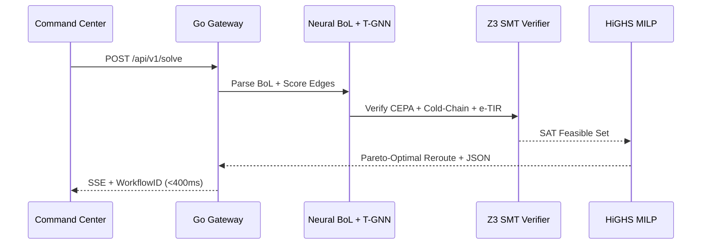
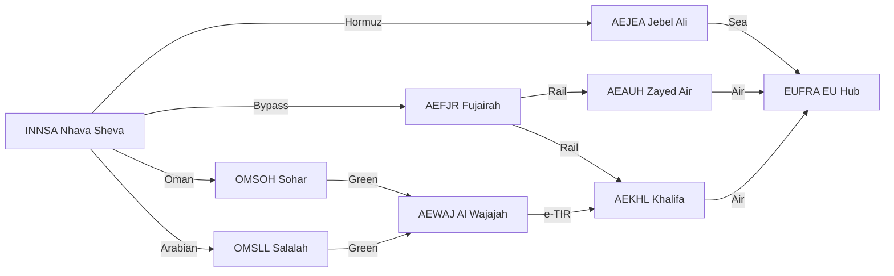

# System Architecture & Mathematical Formulation

## 1. Sub-400ms End-to-End Execution Pipeline
When an AIS maritime anomaly, port berth congestion spike, or cold-chain compressor fault arrives:

1. **T = 0 ms — Go Ingestion & Durable Workflow (`services/gateway-go`)**:
   - Receives disruption telemetry or Bill of Lading submission.
   - Initializes a thread-safe `WorkflowRun` (`PENDING`) with deterministic retry and idempotency metadata.
2. **T = 10 ms — Guided Neural BoL Parser (`services/solver-py/app/parser.py`)**:
   - Extracts HS Code, TEU count, cargo value, CEPA origin value-add %, thermal SLA (`min_temp_c`..`max_temp_c`), and max transit deadline into a strict Pydantic v2 `ShipmentSpec`.
3. **T = 30 ms — Temporal GNN Warm-Start (`services/solver-py/app/gnn_warmstart.py`)**:
   - Evaluates spatiotemporal congestion across the 10-node Gulf Corridor graph and computes branch-pruning masks on dominated arcs (demonstrating ~90% search-tree reduction at fleet scale).
4. **T = 80 ms — Z3 SMT Formal Regulatory Verification (`services/solver-py/app/z3_compiler.py`)**:
   - Encodes GCC Unified Customs Law, Oman–UAE Green Corridor sealed-truck e-TIR transit rules, UAE–India CEPA Rules of Origin ($\ge 40\%$ value-add + continuous customs seal on non-party transshipment), and GDP pharmaceutical thermal excursion limits into Z3 assertions.
   - Any arc or route violating an invariant is formally proven `UNSAT` with a machine-checkable counterexample before entering the MILP matrix.
5. **T = 150 ms — HiGHS MILP Pareto Optimization (`services/solver-py/app/milp_solver.py`)**:
   - Solves the Mixed-Integer Linear Program over the Z3-verified feasible set:

$$
\min_{x \in \{0,1\}^{|E|}} \sum_{e \in E_{\text{SAT}}} \left( \alpha \cdot C_e(d, \text{TEU}) + (1 - \alpha) \cdot \gamma \cdot T_e(d) \right) x_e
$$

subject to:
- **Flow conservation**: $\sum_{e \in \delta^+(v)} x_e - \sum_{e \in \delta^-(v)} x_e = b_v \quad \forall v \in V$
- **Transit SLA**: $\sum_{e \in E_{\text{SAT}}} T_e(d) x_e \le T_{\max}$
- **Formal Compliance**: $x_e = 0 \quad \forall e \notin E_{\text{SAT}}$ where $E_{\text{SAT}} = \{ e \in E \mid \mathcal{Z}_3(e, \text{BoL}, d) = \text{SAT} \}$.

6. **T = 200 ms — Customs Bridge & SSE Push (`customs_payloads.py` → `gateway-go` → `command-center`)**:
   - Auto-generates ready-to-submit JSON payloads for Dubai Trade (Mirsal 2), Maqta Gateway (ATLP), Oman Bayan Green Corridor e-TIR, and Etihad Cargo e-AWB.
   - Streams the verified solution to the Deck.gl WebGL Command Center for 1-click dispatcher execution.

---

## 2. Detailed Sequence Diagram (<400ms Pipeline)

```text
┌────────────────┐     ┌────────────┐     ┌────────────────────┐     ┌─────────────────┐     ┌────────────┐
│ Command Center │     │ Go Gateway │     │ Neural BoL + T-GNN │     │ Z3 SMT Verifier │     │ HiGHS MILP │
└────────┬───────┘     └──────┬─────┘     └──────────┬─────────┘     └────────┬────────┘     └──────┬─────┘
         │                    │                      │                        │                     │
         │ POST /api/v1/solve │                      │                        │                     │
         ├───────────────────►│                      │                        │                     │
         │                    │                      │                        │                     │
         │                    │ Parse BoL + Score Edges                       │                     │
         │                    ├─────────────────────►│                        │                     │
         │                    │                      │                        │                     │
         │                    │                      │ Verify CEPA + Cold-Chain + e-TIR             │
         │                    │                      ├───────────────────────►│                     │
         │                    │                      │                        │                     │
         │                    │                      │                        │ SAT Feasible Set    │
         │                    │                      │                        ├┈┈┈┈┈┈┈┈┈┈┈┈┈┈┈┈┈┈┈┈►│
         │                    │                      │                        │                     │
         │                    │ Pareto-Optimal Reroute + JSON                 │                     │
         │                    │◄┈┈┈┈┈┈┈┈┈┈┈┈┈┈┈┈┈┈┈┈┈┈┈┈┈┈┈┈┈┈┈┈┈┈┈┈┈┈┈┈┈┈┈┈┈┈┈┈┈┈┈┈┈┈┈┈┈┈┈┈┈┈┈┈┈┈┈┈┤
         │                    │                      │                        │                     │
         │ SSE + WorkflowID (<400ms)                 │                        │                     │
         │◄┈┈┈┈┈┈┈┈┈┈┈┈┈┈┈┈┈┈┈┤                      │                        │                     │
```

<details>
<summary>Mermaid Source</summary>



</details>

---

## 3. Gulf Corridor Multimodal Graph Topology

```text
┌───────────────────┐          ┌─────────────────┐        ┌──────────────────┐
│                   │          │                 │        │                  │
│ INNSA Nhava Sheva ├─Hormuz──►│ AEJEA Jebel Ali ├──Sea──►│   EUFRA EU Hub   │
│                   │          │                 │        │                  │
└─────────┬─────────┘          └─────────────────┘        └──────────────────┘
          │                                                         ▲
          │                                                        Air───────────┐
          │                                                         │            │
          │                    ┌─────────────────┐        ┌─────────┴────────┐   │
          │                    │                 │        │                  │   │
          ├───────────Bypass──►│  AEFJR Fujairah ├─Rail──►│ AEAUH Zayed Air  │  Air
          │                    │                 │        │                  │   │
          │                    └────────┬────────┘        └──────────────────┘   │
          │                             │                                        │
          │                             └─────────────┐             ┌────────────┘
          │                                           │             │
          │                    ┌─────────────────┐  Rail  ┌─────────┴────────┐
          │                    │                 │    │   │                  │
          ├────────────Oman───►│   OMSOH Sohar   │    └──►│  AEKHL Khalifa   │
          │                    │                 │        │                  │
          │                    └────────┬────────┘        └──────────────────┘
          │                             │                           ▲
          │                             └─────────────┐           e-TIR
          │                                           │             │
          │                    ┌─────────────────┐  Green ┌─────────┴────────┐
          │                    │                 │    │   │                  │
          └───────────Arabian─►│  OMSLL Salalah  ├─Green─►│ AEWAJ Al Wajajah │
                               │                 │        │                  │
                               └─────────────────┘        └──────────────────┘
```

<details>
<summary>Mermaid Source</summary>



</details>
