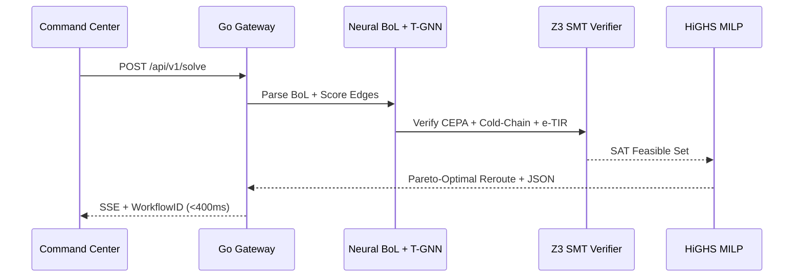
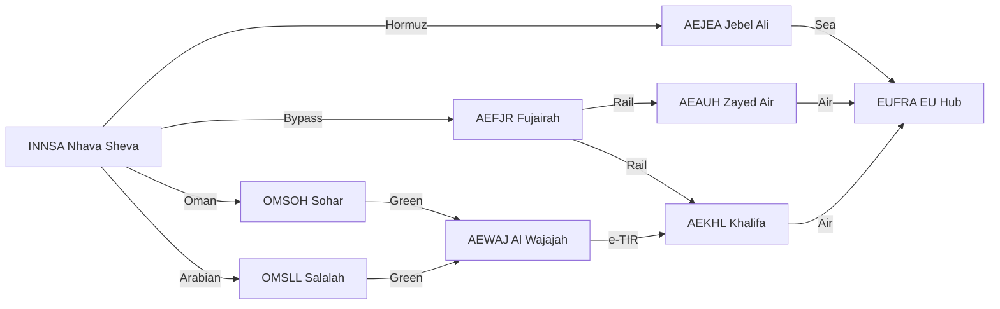

# ParetoLane — System Architecture & Mathematical Formulation

*Brand: **ParetoLane** ("The Autonomous Cargo Rerouting & Customs Engine") · Technical Core: Neuro-Symbolic Corridor Solver.*

## 1. Sub-400ms End-to-End Execution Pipeline
When an AIS maritime anomaly (MarineTraffic `VI06`), container milestone webhook (Vizion DCSA / Project44), reefer alarm (Carrier Lynx), or freight-rate spike (Xeneta v3) arrives:

> **Phase 1 Implementation Status:** The end-to-end neuro-symbolic stack now executes:
> - **Zero-Hallucination Canonical Gate (`POST /api/v1/validate-shipment`)**: `ZeroHallucinationParser` validates DCSA eBL 3.0 / IATA ONE Record manifests and emits `422 VALIDATION_HOLD` if mandatory customs fields are missing.
> - **Trained PyG/ONNX `TemporalCorridorGATv2` (`services/solver-py/app/gnn_warmstart.py`)**: Runs live ONNX Runtime inference (`corridor_tgnn.onnx`) to score edges and prioritize MILP branch ordering.
> - **Time-Expanded HiGHS MILP + Z3 Benders Lazy Cuts (`services/solver-py/app/milp_solver.py`, `z3_compiler.py`)**: Optimizes multi-wave edge-flow variables with dynamic `EdgeTelemetryOverride` injection and formal Chapter 30 QF_LIRA verification (India–UAE CEPA Annex 3B, GCC e-TIR / Makasa, EU ICS2 Release 3, and piecewise-linear Haynes MKT cold-chain physics).
> - **Durable PostgreSQL 17 Persistence (`services/gateway-go/db.go`)**: Checkpoints `WorkflowRun` and `TelemetrySnapshot` JSONB state via `pgx/v5` when `DATABASE_URL` is configured, with automatic hermetic in-memory fallback for unit tests and local dev.

1. **T = 0 ms — Go Ingestion, Live Telemetry & Durable Workflow (`services/gateway-go`)**:
   - Ingests disruption webhooks (`/api/v1/telemetry/webhooks/{vizion,carrier-lynx,project44}`), polling refreshes (`/api/v1/telemetry/refresh`), and solve/validation requests (`/api/v1/solve`, `/api/v1/validate-shipment`).
   - Merges active `EdgeTelemetryOverride` patches into outbound `/solve` payloads, initializes `WorkflowRun` (`PENDING`), checkpoints to PostgreSQL (`workflow_runs` & `telemetry_snapshots`), and fans out `workflow_update` and `telemetry_update` SSE events.
2. **T = 10 ms — Guided BoL Parser & Zero-Hallucination Gate (`services/solver-py/app/parser.py`)**:
   - Extracts HS Code, TEU count, cargo value, CEPA origin value-add %, thermal SLA (`min_temp_c`..`max_temp_c`), and max transit deadline into a strict Pydantic v2 `ShipmentSpec`, or enforces DCSA eBL 3.0 / GCC 12-digit HS completeness via `ValidationHold`.
3. **T = 30 ms — Temporal GNN Warm-Start (`services/solver-py/app/gnn_warmstart.py`)**:
   - Runs the exported ONNX `TemporalCorridorGATv2` model over the 10-node Gulf Corridor graph (with live `edge_overrides` applied) to rank edges and compute fleet-scale branch-pruning telemetry.
4. **T = 80 ms — Z3 SMT Formal Regulatory Verification (`services/solver-py/app/z3_compiler.py`)**:
   - Encodes GCC Unified Customs Law, Oman–UAE Green Corridor sealed-truck e-TIR transit rules (Annex 11 message sequence + seal lineage), UAE–India CEPA Rules of Origin ($\ge 40\%$ FOB / $\ge 35\%$ EXW + continuous customs seal on non-party transshipment), EU ICS2 Release 3 PLACI/ENS windows, and GDP pharmaceutical thermal excursion limits (including linearized Haynes MKT) into Z3 assertions.
   - Any arc or route violating an invariant is formally proven `UNSAT` with a machine-checkable counterexample and generates a Benders lazy no-good cut in HiGHS.
5. **T = 150 ms — Time-Expanded HiGHS MILP Pareto Optimization (`services/solver-py/app/milp_solver.py`)**:
   - Solves the Mixed-Integer Linear Program over the time-expanded wave graph with Z3 Benders lazy cuts:

$$
\min_{x \in \{0,1\}^{|E|}} \sum_{e \in E_{\text{SAT}}} \left( \alpha \cdot C_e(d, \text{TEU}) + (1 - \alpha) \cdot \gamma \cdot T_e(d) \right) x_e
$$

subject to:
- **Flow conservation**: $\sum_{e \in \delta^+(v)} x_e - \sum_{e \in \delta^-(v)} x_e = b_v \quad \forall v \in V$
- **Transit SLA**: $\sum_{e \in E_{\text{SAT}}} T_e(d) x_e \le T_{\max}$
- **Formal Compliance**: $x_e = 0 \quad \forall e \notin E_{\text{SAT}}$ where $E_{\text{SAT}} = \{ e \in E \mid \mathcal{Z}_3(e, \text{BoL}, d) = \text{SAT} \}$.

6. **T = 200 ms — Customs Bridge & SSE Push (`customs_payloads.py` → `gateway-go` → `command-center`)**:
   - Auto-generates ready-to-submit JSON payloads for Dubai Trade (Mirsal 2), Maqta Gateway (ATLP), Oman Bayan Green Corridor e-TIR, and Etihad Cargo e-AWB.
   - Streams the verified solution to the Deck.gl WebGL Command Center for 1-click dispatcher execution.

---

## 2. Detailed Sequence Diagram (<400ms Pipeline)

```text
┌────────────────┐     ┌────────────┐     ┌────────────────────┐     ┌─────────────────┐     ┌────────────┐
│ Command Center │     │ Go Gateway │     │ Neural BoL + T-GNN │     │ Z3 SMT Verifier │     │ HiGHS MILP │
└────────┬───────┘     └──────┬─────┘     └──────────┬─────────┘     └────────┬────────┘     └──────┬─────┘
         │                    │                      │                        │                     │
         │ POST /api/v1/solve │                      │                        │                     │
         ├───────────────────►│                      │                        │                     │
         │                    │                      │                        │                     │
         │                    │ Parse BoL + Score Edges                       │                     │
         │                    ├─────────────────────►│                        │                     │
         │                    │                      │                        │                     │
         │                    │                      │ Verify CEPA + Cold-Chain + e-TIR             │
         │                    │                      ├───────────────────────►│                     │
         │                    │                      │                        │                     │
         │                    │                      │                        │ SAT Feasible Set    │
         │                    │                      │                        ├┈┈┈┈┈┈┈┈┈┈┈┈┈┈┈┈┈┈┈┈►│
         │                    │                      │                        │                     │
         │                    │ Pareto-Optimal Reroute + JSON                 │                     │
         │                    │◄┈┈┈┈┈┈┈┈┈┈┈┈┈┈┈┈┈┈┈┈┈┈┈┈┈┈┈┈┈┈┈┈┈┈┈┈┈┈┈┈┈┈┈┈┈┈┈┈┈┈┈┈┈┈┈┈┈┈┈┈┈┈┈┈┈┈┈┈┤
         │                    │                      │                        │                     │
         │ SSE + WorkflowID (<400ms)                 │                        │                     │
         │◄┈┈┈┈┈┈┈┈┈┈┈┈┈┈┈┈┈┈┈┤                      │                        │                     │
```

<details>
<summary>Mermaid Source</summary>



</details>

---

## 3. Gulf Corridor Multimodal Graph Topology

```text
┌───────────────────┐          ┌─────────────────┐        ┌──────────────────┐
│                   │          │                 │        │                  │
│ INNSA Nhava Sheva ├─Hormuz──►│ AEJEA Jebel Ali ├──Sea──►│   EUFRA EU Hub   │
│                   │          │                 │        │                  │
└─────────┬─────────┘          └─────────────────┘        └──────────────────┘
          │                                                         ▲
          │                                                        Air───────────┐
          │                                                         │            │
          │                    ┌─────────────────┐        ┌─────────┴────────┐   │
          │                    │                 │        │                  │   │
          ├───────────Bypass──►│  AEFJR Fujairah ├─Rail──►│ AEAUH Zayed Air  │  Air
          │                    │                 │        │                  │   │
          │                    └────────┬────────┘        └──────────────────┘   │
          │                             │                                        │
          │                             └─────────────┐             ┌────────────┘
          │                                           │             │
          │                    ┌─────────────────┐  Rail  ┌─────────┴────────┐
          │                    │                 │    │   │                  │
          ├────────────Oman───►│   OMSOH Sohar   │    └──►│  AEKHL Khalifa   │
          │                    │                 │        │                  │
          │                    └────────┬────────┘        └──────────────────┘
          │                             │                           ▲
          │                             └─────────────┐           e-TIR
          │                                           │             │
          │                    ┌─────────────────┐  Green ┌─────────┴────────┐
          │                    │                 │    │   │                  │
          └───────────Arabian─►│  OMSLL Salalah  ├─Green─►│ AEWAJ Al Wajajah │
                               │                 │        │                  │
                               └─────────────────┘        └──────────────────┘
```

<details>
<summary>Mermaid Source</summary>



</details>
