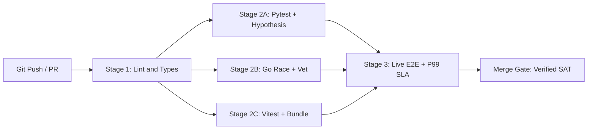

# Testing & CI/CD Guardrails Architecture

This document defines the Senior SWE Testing & Continuous Integration Guardrails for the **Neuro-Symbolic Gulf Corridor Solver**.

Because this system dispatches bonded multi-modal customs transshipments across India, Oman, the UAE, and Europe under strict **UAE-India CEPA Rules of Origin**, **GCC e-TIR Customs Bonds**, and **EU/MOHAP GDP Cold-Chain SLAs**, standard CRUD testing is insufficient. Our guardrails are structured around two orthogonal engineering frameworks:

1. **The Granularity Framework (The Neuro-Symbolic Testing Pyramid)**: What we test at each layer of abstraction, from sub-millisecond unit checks and mathematical property fuzzing up to live cross-service end-to-end orchestration.
2. **The Execution Framework (Pipeline Topology & Cadence)**: How and when those checks execute locally (`make ci`) and in GitHub Actions (`.github/workflows/ci.yml`) to maximize developer velocity while guaranteeing zero regulatory hallucinations and `<400ms` P99 latency.

---

## 1. The Granularity Framework (The 5-Layer Testing Pyramid)

In a tri-lingual neuro-symbolic architecture (`Go 1.26` + `Python 3.12 Z3/HiGHS` + `React 19/TypeScript`), we augment the classic Testing Pyramid with **Layer 1.5 (Formal & Property-Based Invariant Fuzzing)** and **Layer 2/3 (Tri-Lingual Contract & Stage Latency SLA Gates)**:

| Layer | Granularity Tier | Target Scope & Invariants Protected | Tooling & Entrypoint | Execution Budget |
| :--- | :--- | :--- | :--- | :--- |
| **L0** | **Static, Types & Formatting** | Zero `any` escape hatches, strict AST linting, formatting parity, Go concurrency vet checks. | `ruff check`, `ruff format --check`, `gofmt -l`, `go vet`, `tsc --noEmit` (`make lint`) | `< 5s` local |
| **L1** | **Isolated Unit & State Machine** | Deterministic route physics, Z3 axiom compilation, HiGHS MILP solver, Go `WorkflowStore` mutex safety (`-race`), React 19 UI + native `<dialog>` & progressive enhancement fallbacks. | `pytest` (`>=95%` branch cov), `go test -race`, `vitest run` (`make test`) | `< 5s` local |
| **L1.5** | **Property-Based & Formal Fuzzing** | **Mathematical & Regulatory Invariants** over randomized `(ShipmentSpec, DisruptionState, alpha)` tuples: (1) Unbonded spot routes are *always* `UNSAT` in Z3; (2) MILP optimal routes are *always* `SAT` when feasible; (3) Pareto frontier is strictly monotonic in cost vs. hours; (4) T-GNN risk scores are bounded in `[0, 1]` and monotonic with Hormuz delay; (5) Guided BoL parser never hallucinates out-of-bounds schemas. | `hypothesis` (`services/solver-py/tests/test_property_invariants.py` via `make test-py-property`) | `< 3s` (145+ generated cases) |
| **L2** | **Tri-Lingual Boundary Contracts** | **Zero Schema Drift** across `services/solver-py/app/models.py` (Pydantic v2), `services/gateway-go/workflow.go` (Go JSON tags), and `apps/command-center/src/types.ts` (TypeScript interfaces). Any field added or renamed in one language without updating the others fails immediately. | AST/Reflection parity test (`test_trilingual_schema_contract_parity` via `make test-contracts`) | `< 0.5s` |
| **L3 & L4** | **Live Cross-Service E2E & `<400ms` P99 SLA Gate** | Real HTTP/SSE orchestration (`gateway-go` -> live `solver-py` Uvicorn process) + 45-run statistical P99 stage latency gates enforcing `AGENTS.md` budgets. | `test_stage_and_p99_latency_sla_budgets` + `TestLiveSolverEndToEndContractAndSLAGate` (`make test-sla` & `make test-e2e`) | `< 3s` |

---

## 2. The Execution Framework (Pipeline DAG & Fail-Fast Stages)

The Execution Framework governs **stage ordering**, **parallel fan-out**, **caching**, and **merge gates** in `.github/workflows/ci.yml` and the local `Makefile`.

### Pipeline Execution DAG (`mermaid-ascii`)

```text
┌───────────────┐     ┌─────────────────────────┐     ┌───────────────────────────────┐     ┌─────────────────────────────┐     ┌──────────────────────────┐
│               │     │                         │     │                               │     │                             │     │                          │
│ Git Push / PR ├────►│ Stage 1: Lint and Types ├────►│ Stage 2A: Pytest + Hypothesis ├────►│ Stage 3: Live E2E + P99 SLA ├────►│ Merge Gate: Verified SAT │
│               │     │                         │     │                               │     │                             │     │                          │
└───────────────┘     └────────────┬────────────┘     └───────────────────────────────┘     └─────────────────────────────┘     └──────────────────────────┘
                                   │                                                                       ▲                                                
                                   │                                                                       │                                                
                                   │                                                                       │                                                
                                   │                                                                       │                                                
                                   │                                                                       │                                                
                                   │                  ┌───────────────────────────────┐                    │                                                
                                   │                  │                               │                    │                                                
                                   ├─────────────────►│    Stage 2B: Go Race + Vet    ├────────────────────┤                                                
                                   │                  │                               │                    │                                                
                                   │                  └───────────────────────────────┘                    │                                                
                                   │                                                                       │                                                
                                   │                                                                       │                                                
                                   │                                                                       │                                                
                                   │                                                                       │                                                
                                   │                                                                       │                                                
                                   │                  ┌───────────────────────────────┐                    │                                                
                                   │                  │                               │                    │                                                
                                   └─────────────────►│   Stage 2C: Vitest + Bundle   ├────────────────────┘                                                
                                                      │                               │                                                                     
                                                      └───────────────────────────────┘                                                                     
```

<details>
<summary>Mermaid Source</summary>



</details>

---

## 3. Enforced Latency & Coverage Ratchets

Every commit and pull request is gated against both **code coverage ratchets** and **real-time P99 execution budgets**:

| Pipeline Stage / Component | Enforced SLA / Gate | Observed Baseline | Guardrail Test |
| :--- | :--- | :--- | :--- |
| **Stage 1: Go Gateway Ingest** | `< 10.0 ms` | `~0.08 ms` | `TestLiveSolverEndToEndContractAndSLAGate` |
| **Stage 2: Guided BoL Schema Extraction** | `< 25.0 ms` (P99) | `~0.15 ms` | `test_stage_and_p99_latency_sla_budgets` |
| **Stage 3: T-GNN Warm-Start Variable Pruning** | `< 30.0 ms` (P99) | `~0.45 ms` | `test_stage_and_p99_latency_sla_budgets` |
| **Stage 4: Z3 SMT Check + HiGHS MILP Solve** | `< 200.0 ms` (P99) | `~16.20 ms` | `test_stage_and_p99_latency_sla_budgets` |
| **Stage 5: Customs Bridge & SSE Push** | `< 50.0 ms` (P99) | `~0.35 ms` | `test_stage_and_p99_latency_sla_budgets` |
| **Total End-to-End Pipeline (`gateway-go` <-> `solver-py`)** | `< 400.0 ms` (P99) | `~18.02 ms` | `TestLiveSolverEndToEndContractAndSLAGate` |
| **Python Solver Branch Coverage (`services/solver-py`)** | `>= 95.0%` | `100.0%` | `pytest --cov=app --cov-fail-under=95` |

---

## 4. Developer Command Reference

```bash
make ci                 # Run the complete 3-stage pipeline locally (Lint -> Unit/Property/Contract -> Live E2E)
make lint               # Stage 1: Ruff lint/format, gofmt/go vet, and TypeScript strict check
make test-py            # Stage 2A: All Python unit, property, contract, and SLA tests with >=95% coverage gate
make test-py-property   # Run only L1.5 Hypothesis mathematical/Z3 property fuzzing
make test-contracts     # Run only L2 Tri-Lingual (Python <-> Go <-> TypeScript) schema parity checks
make test-sla           # Run only L3 45-iteration P99 stage latency benchmark gates
make test-go            # Stage 2B: Go vet + race-checked unit & concurrency tests
make test-ui            # Stage 2C: Frontend Vitest component, native <dialog>, and A11y tests
make test-e2e           # Stage 3: Boot live solver-py and run Go <-> Python E2E contract & <400ms P99 SLA gate
```
