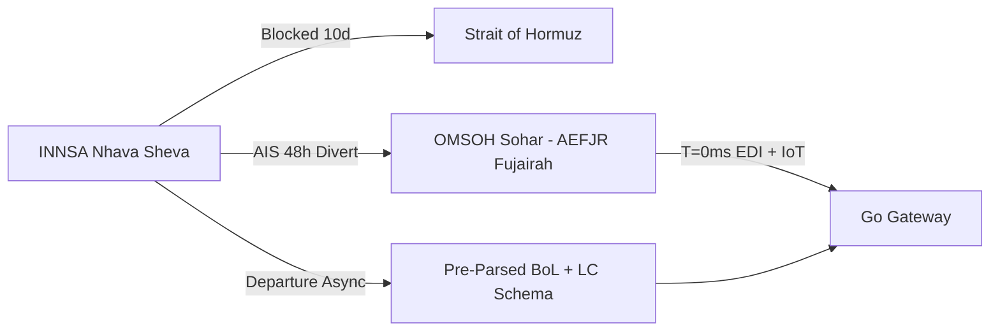
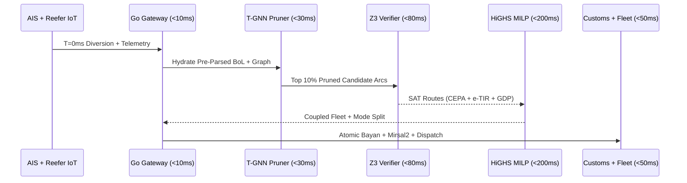
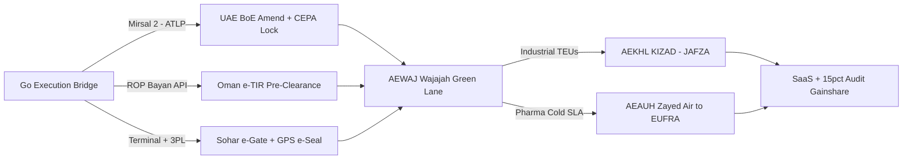

# End-to-End Corridor Architecture & User Stories

This document defines the hardened **Neuro-Symbolic Corridor Control Plane** architecture (rendered via `mermaid-ascii`) and the end-to-end **User Stories & Acceptance Criteria** across all operational personas.

---

## 1. Hardened End-to-End Architecture (`mermaid-ascii`)

### Stage 0 & Stage 1: Async Voyage Pre-Ingestion & Physical-to-Digital Trigger (`T = 0 ms`)

> **Architectural Refinement:** Cold OCR/LLM extraction of 100+ line-item PDF Bills of Lading, Commercial Invoices, and Letters of Credit (LCs) executes **asynchronously upon departure from `INNSA` (Nhava Sheva)**. When the AIS diversion / EDI amendment fires 48 hours before arrival at `OMSOH` (Sohar) or `AEFJR` (Fujairah), the Go Gateway hydrates the pre-validated schema in `< 10 ms`.

```text
┌───────────────────┐                  ┌──────────────────────────────┐                  ┌────────────┐
│                   │                  │                              │                  │            │
│ INNSA Nhava Sheva ├───Blocked─10d───►│       Strait of Hormuz       │                  │ Go Gateway │
│                   │                  │                              │                  │            │
└─────────┬─────────┘                  └──────────────────────────────┘                  └────────────┘
          │                                                                                     ▲      
          │                                                                                     │      
          │                            ┌──────────────────────────────┐                         │      
          │                            │                              │                         │      
          ├───────────AIS─48h─Divert──►│ OMSOH Sohar - AEFJR Fujairah ├─────T=0ms─EDI─+─IoT─────┤      
          │                            │                              │                         │      
          │                            └──────────────────────────────┘                         │      
          │                                                                                     │      
          │                                                                                     │      
          │                            ┌──────────────────────────────┐                         │      
          │                            │                              │                         │      
          └───────────Departure─Async─►│  Pre-Parsed BoL + LC Schema  ├─────────────────────────┘      
                                       │                              │                                
                                       └──────────────────────────────┘                                
```

<details>
<summary>Mermaid Source</summary>



</details>

---

### Stage 2: The Neuro-Symbolic Control Plane (`< 400 ms` P99 SLA)

> **Architectural Refinement:**
> - **Zero Regulatory Hallucination:** Guided extraction (`parser.py`) emits strict Pydantic v2 / Protobuf schemas; no route can bypass `z3_compiler.py` (`z3.sat`).
> - **Coupled Fleet & Border Constraints:** `milp_solver.py` solves over Z3-verified arcs with coupled capacity constraints (bonded trucks, GPS e-seals, terminal crane slots) and T-GNN probabilistic border queue times at Al Wajajah / Hatta.

```text
┌──────────────────┐     ┌────────────────────┐     ┌──────────────────────┐     ┌─────────────────────┐     ┌─────────────────────┐     ┌─────────────────────────┐
│ AIS + Reefer IoT │     │ Go Gateway (<10ms) │     │ T-GNN Pruner (<30ms) │     │ Z3 Verifier (<80ms) │     │ HiGHS MILP (<200ms) │     │ Customs + Fleet (<50ms) │
└─────────┬────────┘     └──────────┬─────────┘     └───────────┬──────────┘     └──────────┬──────────┘     └──────────┬──────────┘     └────────────┬────────────┘
          │                         │                           │                           │                           │                             │
          │ T=0ms Diversion + Telemetry                         │                           │                           │                             │
          ├────────────────────────►│                           │                           │                           │                             │
          │                         │                           │                           │                           │                             │
          │                         │ Hydrate Pre-Parsed BoL + Graph                        │                           │                             │
          │                         ├──────────────────────────►│                           │                           │                             │
          │                         │                           │                           │                           │                             │
          │                         │                           │ Top 10% Pruned Candidate Arcs                         │                             │
          │                         │                           ├──────────────────────────►│                           │                             │
          │                         │                           │                           │                           │                             │
          │                         │                           │                           │ SAT Routes (CEPA + e-TIR + GDP)                         │
          │                         │                           │                           ├┈┈┈┈┈┈┈┈┈┈┈┈┈┈┈┈┈┈┈┈┈┈┈┈┈┈►│                             │
          │                         │                           │                           │                           │                             │
          │                         │ Coupled Fleet + Mode Split│                           │                           │                             │
          │                         │◄┈┈┈┈┈┈┈┈┈┈┈┈┈┈┈┈┈┈┈┈┈┈┈┈┈┈┈┈┈┈┈┈┈┈┈┈┈┈┈┈┈┈┈┈┈┈┈┈┈┈┈┈┈┈┈┈┈┈┈┈┈┈┈┈┈┈┈┈┈┈┈┈┈┈┈┈┈┈┈┈┈┈┤                             │
          │                         │                           │                           │                           │                             │
          │                         │ Atomic Bayan + Mirsal2 + Dispatch                     │                           │                             │
          │                         ├────────────────────────────────────────────────────────────────────────────────────────────────────────────────►│
          │                         │                           │                           │                           │                             │
```

<details>
<summary>Mermaid Source</summary>



</details>

---

### Stage 3 & Stage 4: Digital Bureaucracy, Bonded Corridor & Commercial Settlement

> **Architectural Refinement:**
> - **CEPA Direct-Consignment Preservation:** Explicitly locks UAE–India CEPA preferential duty ($\ge 40\%$ origin value-add + unbroken GPS e-seal Certificate of Non-Manipulation across Oman transit).
> - **Consistent Unit Economics:** Normalizes baseline demurrage at **\$250/TEU/day** (8 days avoided = **\$2,000/TEU** saved) paired with a base SaaS platform tier + **15% verified gainshare (\$300/TEU)**.

```text
┌─────────────────────┐                  ┌───────────────────────────┐    ┌──────────────────────────┐                  ┌──────────────────────────┐    ┌──────────────────────────────┐
│                     │                  │                           │    │                          │                  │                          │    │                              │
│ Go Execution Bridge ├─Mirsal─2─-─ATLP─►│ UAE BoE Amend + CEPA Lock ├───►│ AEWAJ Wajajah Green Lane ├─Industrial─TEUs─►│   AEKHL KIZAD - JAFZA    ├───►│ SaaS + 15pct Audit Gainshare │
│                     │                  │                           │    │                          │                  │                          │    │                              │
└──────────┬──────────┘                  └───────────────────────────┘    └─────────────┬────────────┘                  └──────────────────────────┘    └──────────────────────────────┘
           │                                                                            ▲                                                                               ▲               
           │                                                                            │                                                                               │               
           │                             ┌───────────────────────────┐                  │                               ┌──────────────────────────┐                    │               
           │                             │                           │                  │                               │                          │                    │               
           ├─────────────ROP─Bayan─API──►│  Oman e-TIR Pre-Clearance ├──────────────────┼──────────────Pharma─Cold─SLA─►│ AEAUH Zayed Air to EUFRA ├────────────────────┘               
           │                             │                           │                  │                               │                          │                                    
           │                             └───────────────────────────┘                  │                               └──────────────────────────┘                                    
           │                                                                            │                                                                                               
           │                                                                            │                                                                                               
           │                             ┌───────────────────────────┐                  │                                                                                               
           │                             │                           │                  │                                                                                               
           └────────────Terminal─+─3PL──►│ Sohar e-Gate + GPS e-Seal ├──────────────────┘                                                                                               
                                         │                           │                                                                                                                  
                                         └───────────────────────────┘                                                                                                                  
```

<details>
<summary>Mermaid Source</summary>



</details>

---

## 2. Epics & User Stories

### Epic 1: Voyage Pre-Ingestion & Physical-to-Digital Trigger (`services/gateway-go`, `parser.py`)

#### US-1.1: Asynchronous Departure Document Extraction
* **As a** Customs Integration Engineer,
* **I want** multi-page PDF Bills of Lading, Commercial Invoices, and Letters of Credit (100+ line items) parsed into strict Pydantic v2 `ShipmentSpec` schemas upon vessel departure from `INNSA` (Nhava Sheva),
* **So that** slow OCR/LLM extraction is off the critical path when a maritime emergency triggers mid-voyage.
* **Acceptance Criteria:**
  1. Extracts 8–12 digit HS code, TEU count, total declared value (USD), India–UAE CEPA origin value-add percentage, thermal SLA range (`min_temp_c`..`max_temp_c`), and max transit hours (`max_transit_hours`).
  2. Rejects malformed or ambiguous regulatory fields with typed validation errors prior to solver hydration.
  3. Pre-parsed `ShipmentSpec` is cached and addressable by `ShipmentID` / `BillOfLading` in `< 10 ms` (or `< 25 ms` on guided re-extraction).

#### US-1.2: 48-Hour AIS Diversion & Reefer Telemetry Trigger
* **As a** Maritime Operations Coordinator,
* **I want** the Go Gateway (`services/gateway-go`) to ingest real-time AIS course-change alerts, carrier EDI Port-of-Discharge amendments ("Liberty Clause invoked → `OMSOH` Sohar / `AEFJR` Fujairah"), and live Reefer IoT temperature telemetry,
* **So that** corridor re-optimization begins 36–48 hours before the vessel touches the unplanned berth.
* **Acceptance Criteria:**
  1. `POST /api/v1/solve` initializes a thread-safe, idempotent `WorkflowRun` (`PENDING` → `SOLVING`) in `< 10 ms`.
  2. Ingests dynamic corridor disruption state (`hormuz_closure`, `red_sea_blockade`, `customs_strike`, `reefer_power_fault`, `none`).
  3. Streams state transitions (`PENDING`, `SOLVING`, `VERIFIED`, `DISPATCHED`, `FAILED`) to subscribed clients over SSE (`/api/v1/stream`).

---

### Epic 2: Spatiotemporal Pruning & Z3 Formal Regulatory Verification (`gnn_warmstart.py`, `z3_compiler.py`)

#### US-2.1: T-GNN Border Queue Prediction & Search-Tree Pruning
* **As a** Corridor Optimization Scientist,
* **I want** the Temporal GNN (`gnn_warmstart.py`) to predict dynamic border wait times at Al Wajajah (`AEWAJ`), Hatta, and Mezyad and prune dominated routing arcs,
* **So that** the downstream SMT/MILP solver evaluates only the top feasible corridor candidates within `< 30 ms`.
* **Acceptance Criteria:**
  1. Scores all candidate routes across the 10-node Gulf Corridor graph using live congestion multipliers and probabilistic inspection buffers.
  2. Produces a warm-start candidate ordering and branch-pruning telemetry (`pruned_variables_pct >= 85%` at fleet scale) in `< 30 ms`.
  3. Never prunes all feasible routes when at least one Z3-compliant path exists (fallback safety invariant).

#### US-2.2: Z3 Theorem Prover Cross-Border & CEPA Verification
* **As a** Trade Compliance Officer,
* **I want** `z3_compiler.py` to formally prove that every candidate reroute satisfies Oman ROP Bayan e-TIR transit rules, UAE Mirsal II / ATLP customs notices, India–UAE CEPA Rules of Origin, and GDP pharmaceutical cold-chain limits,
* **So that** zero unverified or non-compliant routes are ever dispatched (`Zero Regulatory Hallucination Invariant`).
* **Acceptance Criteria:**
  1. **CEPA Direct-Consignment Proof:** Verifies $\text{ValueAdd}_{\text{IN}} \ge 40\%$ AND enforces continuous customs e-seal (`e_tir_sealed == True`) whenever Indian-origin cargo transits overland through Oman (`OMSOH` / `OMSLL` → `AEWAJ`), preserving preferential 0%–5% duty and preventing automatic tariff forfeiture.
  2. **Cold-Chain GDP Invariant:** Proves that cumulative thermal drift across port dwell, overland transit, and border transfer stays strictly within `[min_temp_c, max_temp_c]`, marking standard unrefrigerated or power-faulted arcs `UNSAT` for pharma cargo (HS Chapter 30).
  3. **Machine-Checkable Proof:** Emits a per-route Z3 status (`SAT` / `UNSAT`), formal proof trace, and explicit counterexample assertion whenever a route is rejected, completing in `< 80 ms`.

---

### Epic 3: Coupled Multimodal MILP Optimization (`milp_solver.py`)

#### US-3.1: Pareto-Optimal Cargo Bifurcation (Land-Bridge vs. Air-Bridge)
* **As a** Supply Chain Planner,
* **I want** the HiGHS MILP solver (`milp_solver.py`) to compute the Pareto-optimal split between bonded road/rail (`OMSOH` → `AEWAJ` → `AEKHL`/`AEJEA`) and air freight (`AEAUH` Zayed Int'l → `EUFRA`),
* **So that** standard industrial cargo avoids 8 days of Hormuz demurrage while critical SLA pharma cargo avoids \$150k–\$200k thermal spoilage.
* **Acceptance Criteria:**
  1. Optimizes the weighted objective $\min \sum (\alpha \cdot \text{Cost} + (1 - \alpha) \cdot \gamma \cdot \text{TransitTime})$ strictly over the Z3-verified feasible set $E_{\text{SAT}}$.
  2. Incorporates baseline demurrage bleed (\$250/TEU/day), spoilage penalty exposure, and spot land/air freight rates.
  3. Solves and returns the optimal route, baseline vs. optimized cost/time deltas, and Pareto frontier trade-offs within the `< 200 ms` Stage 4 budget.

#### US-3.2: Coupled Fleet, Crane Slot & e-Seal Capacity Allocation
* **As a** Fleet Dispatch Manager,
* **I want** multi-TEU diversions to respect physical corridor capacity limits (GCC-plated bonded trucks, GPS e-seal inventory at Sohar gate, and terminal offload slots),
* **So that** diverting a 500-TEU shipment does not bottleneck a single border crossing or exhaust cold-chain reefer plugs.
* **Acceptance Criteria:**
  1. Enforces per-route TEU capacity constraints and flags split-shipment allocations when a single mode cannot absorb the full volume within `max_transit_hours`.
  2. Includes probabilistic border inspection buffer times at Al Wajajah / Hatta rather than assuming zero-latency border transit.

---

### Epic 4: Digital Bureaucracy & Physical Corridor Execution (`customs_payloads.py`, `apps/command-center`)

#### US-4.1: Pre-Arrival Dual Customs Filing (UAE Mirsal II / ATLP & Oman Bayan)
* **As a** Licensed Customs Broker,
* **I want** `customs_payloads.py` to generate ready-to-submit, schema-valid JSON payloads for Oman ROP Bayan (GCC Transit Inward Manifest + Transit Bond allocation) and UAE Mirsal II / ATLP (obsolete sea-port BoE cancellation/amendment + CEPA Certificate of Non-Manipulation lock) 36 hours prior to vessel arrival,
* **So that** duty deposits are unfrozen and trucks receive a green customs light before the vessel reaches the Sohar/Fujairah berth.
* **Acceptance Criteria:**
  1. Generates deterministic, auditable JSON payloads for `oman_bayan_etir`, `uae_mirsal2_boe_amendment`, `atlp_kizad_slot`, and (when air-bridge is selected) `etihad_cargo_eawb` in `< 50 ms`.
  2. Attaches broker POA / credential metadata and Letter of Credit (LC) / war-risk deviation waiver flags required for lawful overland diversion.

#### US-4.2: Human-in-the-Loop Tactical Command Center Approval
* **As a** Corridor Dispatcher using the Command Center (`apps/command-center`),
* **I want** to inspect the Deck.gl 3D multimodal route map, the Z3 formal proof certificate, and the customs payloads in a native accessible modal (`<dialog>`), and execute the dispatch with a single click,
* **So that** human oversight is preserved before firing binding regulatory and fleet API transactions.
* **Acceptance Criteria:**
  1. Displays real-time stage latencies, Z3 `SAT`/`UNSAT` badges per candidate route, and cost/time savings vs. the blocked Strait of Hormuz baseline.
  2. Uses native HTML `<dialog>` semantics with keyboard/light-dismiss support (`AGENTS.md` Browser Support Policy) to inspect Z3 proof obligations and customs JSON payloads.
  3. Clicking **Approve & Dispatch** transitions the `WorkflowRun` in `gateway-go` to `DISPATCHED` via `/api/v1/workflows/{id}/approve`.

---

### Epic 5: Commercial Settlement & Audit Telemetry

#### US-5.1: Counterfactual Demurrage Baseline & Gainshare Invoicing
* **As a** 3PL Commercial Director / Platform Finance Lead,
* **I want** the system to record an immutable audit trail comparing the verified Strait of Hormuz queue baseline against actual Sohar-to-KIZAD / AUH clearance timestamps,
* **So that** avoided demurrage and spoilage savings are transparently settled under a hybrid **SaaS + 15% Verified Performance Gainshare** contract.
* **Acceptance Criteria:**
  1. Logs baseline dwell estimate (e.g., 8 days @ \$250/TEU/day = \$2,000/TEU demurrage) alongside actual terminal gate-out and border-crossing telemetry (e.g., 9-hour clearance).
  2. Computes net landed savings (avoided demurrage + avoided SLA spoilage minus incremental bonded land-bridge/air spot cost).
  3. Emits a tamper-evident settlement summary calculating the 15% performance fee (e.g., \$300/TEU on \$2,000 net demurrage saved) linked to the `WorkflowID` and Z3 verification hash.

---

## 3. Summary Traceability Matrix

| Stage | Component | Target Latency SLA | Key Formal / Operational Guarantee | User Stories |
| :--- | :--- | :--- | :--- | :--- |
| **Stage 0** | Async Voyage Pre-Ingest (`parser.py`) | Off critical path (`< 25 ms` warm) | Strict Pydantic v2 `ShipmentSpec` schema | US-1.1 |
| **Stage 1** | Go Gateway & SSE Stream (`gateway-go`) | `< 10 ms` | Idempotent `WorkflowRun` state machine | US-1.2 |
| **Stage 2** | T-GNN Spatiotemporal Pruner (`gnn_warmstart.py`) | `< 30 ms` | $\ge 85\%$ search-tree pruning + border queue prediction | US-2.1 |
| **Stage 3A** | Z3 SMT Regulatory Compiler (`z3_compiler.py`) | `< 80 ms` | `z3.sat` proof for CEPA, e-TIR seal, and GDP cold-chain | US-2.2 |
| **Stage 3B** | HiGHS MILP Optimizer (`milp_solver.py`) | `< 120 ms` (`< 200 ms` combined) | Pareto-optimal mode split + coupled capacity constraints | US-3.1, US-3.2 |
| **Stage 4** | Customs Bridge & Command Center (`customs_payloads.py`) | `< 50 ms` | Atomic Mirsal II / ATLP / Bayan payloads + `<dialog>` review | US-4.1, US-4.2, US-5.1 |
